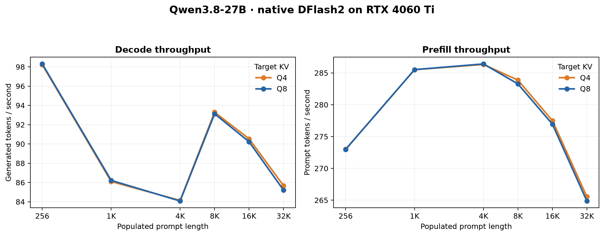
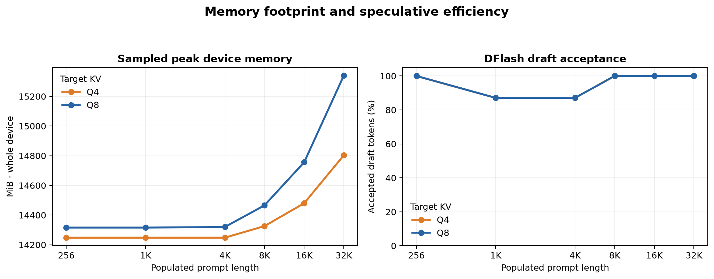

<div align="center">

# Qwen3.8-27B on a 16 GB RTX 4060 Ti

### Context scaling with the Open-Jet CUDA megakernel and native DFlash2

**A reproducible benchmark kit for measuring decode speed, prefill, speculative acceptance, and VRAM as the prompt grows.**


</div>

---

## Results at a glance

These measurements use the ISTA-DASLab [`Qwen3.8-27B-GSQ-RCO-IQ3_S-mtp.gguf`](https://huggingface.co/ISTA-DASLab/Qwen3.8-27B-GSQ-RCO-GGUF) target with native DFlash2, comparing the custom Q4 and Q8 **target KV caches**. The target weights are GSQ-RCO non-uniform mixed precision (3.55 BPW), not a standard Q4_K_M target. The measured workload populated prompts up to **32,768 tokens**. Context capacity is the engine's configured maximum and includes generation/workspace headroom; it is not the same as the number of prompt tokens actually processed.





| Populated prompt | Context capacity | Q8 decode | Q4 decode | Q8 peak VRAM | Q4 peak VRAM |
|---:|---:|---:|---:|---:|---:|
| 256 | 4,096 | 98.30 tok/s | 98.23 tok/s | 14,316 MiB | 14,248 MiB |
| 1,024 | 4,096 | 86.22 tok/s | 86.10 tok/s | 14,316 MiB | 14,248 MiB |
| 4,096 | 4,224 | 84.08 tok/s | 84.13 tok/s | 14,320 MiB | 14,248 MiB |
| 8,192 | 8,320 | 93.13 tok/s | 93.29 tok/s | 14,466 MiB | 14,326 MiB |
| 16,384 | 16,512 | 90.23 tok/s | 90.54 tok/s | 14,756 MiB | 14,480 MiB |
| 32,768 | 32,896 | 85.21 tok/s | 85.68 tok/s | 15,340 MiB | 14,803 MiB |

At the largest measured prompt, Q4 used **537 MiB less sampled whole-device memory** than Q8, while measured decode throughput was about **0.55% higher**. This is one run per point, so the small speed difference is not evidence of a reliable throughput win. The practical result is the extra memory headroom Q4 can trade for a larger context.

The benchmark owner has separately run the Q4 configuration with a **72,000-token context capacity**. That capacity result is not a 72K populated-prompt throughput measurement and is not included as a data point here.

## What this measures

- **Target:** `models--ISTA-DASLab--Qwen3.8-27B-GSQ-RCO-GGUF/Qwen3.8-27B-GSQ-RCO-IQ3_S-mtp.gguf`, non-uniform mixed precision, approximately 11.28 GiB on disk. IQ3_S is the overall label; per-tensor types vary.
- **Draft:** [`z-lab/Qwen3.8-27B-DFlash2-GGUF`](https://huggingface.co/z-lab/Qwen3.8-27B-DFlash2-GGUF), `Qwen3.8-27B-DFlash2-Q4_K_M.gguf`, approximately 1.05 GiB on disk; five draft layers and depth 7 in the benchmark.
- **Execution:** Open-Jet's custom CUDA megakernel, native DFlash2 path, on an RTX 4060 Ti 16 GB (Ada Lovelace, compute capability 8.9 / `sm_89`, 34 SMs), at stock clocks.
- **KV formats:** custom Q8 and Q4 target caches. Q4 is lossy and can change logits and generated output. It is evaluated here for performance and memory, not as a proof of output equivalence or preserved model quality.
- **Prompt fixture:** `prompt.ids` contains a short tokenized Qwen prompt. The runner repeats its body to build deterministic exact-length prompts. Repetition makes a controlled load test, but can make DFlash acceptance unrepresentative of ordinary conversations.
- **Sampling:** the published CSV contains one measured repetition at each prompt/KV point and 64 generated tokens per run. Acceptance happened to be 87.1% or 100% on these points. A single repetition does not quantify run-to-run variation.
- **VRAM:** sampled with `nvidia-smi` for the whole device, so display and background processes contribute. Brief peaks between samples can be missed.

The table and plotted CSV are the measured source for the charts: [`results.csv`](results.csv). The original combined plot is also available as [PNG](assets/context-scaling.png), [SVG](assets/context-scaling.svg), and [PDF](assets/context-scaling.pdf).

## Run it

Run commands from the repository root. The target and draft GGUFs are not copied into this showcase; point the runner at your own files. Build the megakernel executable first if it is not already available. For this repository's Ada build, the project Makefile provides the `qwen38_dflash` target with `ARCH=89`.

```bash
make -C open-jet/megakernel ARCH=89 qwen38_dflash
python3 -m venv .venv
. .venv/bin/activate
python -m pip install -r open-jet/megakernel/bench/context-scaling-showcase/requirements.txt

TARGET_GGUF="/path/to/Qwen3.8-27B-GSQ-RCO-IQ3_S-mtp.gguf"
DRAFT_GGUF="/path/to/Qwen3.8-27B-DFlash2-Q4_K_M.gguf"
MK_BIN="open-jet/megakernel/qwen38_dflash"

python3 open-jet/megakernel/bench/context-scaling-showcase/context_scaling.py \
  --model "$TARGET_GGUF" \
  --draft-model "$DRAFT_GGUF" \
  --binary "$MK_BIN" \
  --llama-lib-dir llama.cpp/build/bin \
  --lengths 256 1024 4096 8192 16384 32768 \
  --kv-formats q8 q4 \
  --tokens 128 --reps 3 --depth 7 --prefill-chunk 128 \
  --output open-jet/megakernel/bench/context-scaling-showcase/run-output
```

The runner starts a fresh process for each prompt length and KV format, records per-run output, logs, JSON and CSV, and generates a combined plot. Longer prompts take longer and need more free VRAM. Close other GPU workloads before running. The full sweep can take several minutes and will write generated artifacts under the ignored `run-output/` directory.

To create the two README charts from any compatible CSV:

```bash
python3 open-jet/megakernel/bench/context-scaling-showcase/plot_results.py \
  --csv open-jet/megakernel/bench/context-scaling-showcase/run-output/results.csv \
  --output open-jet/megakernel/bench/context-scaling-showcase/run-output/assets
```

For a larger **capacity** test, increase prompt length while reserving room for generation and workspace. For example, a prompt around 71,808 tokens with 128 generated tokens and 64 tokens of configured headroom requests about 72,000 context capacity. Change `--lengths` and `--tokens` accordingly; a successful capacity allocation alone does not report throughput at that populated length.

## Files

| File | Purpose |
|---|---|
| [`context_scaling.py`](context_scaling.py) | Runs the megakernel sweep and captures speed, acceptance, and sampled VRAM. |
| [`plot_results.py`](plot_results.py) | Produces the focused plots embedded above from a results CSV. |
| [`prompt.ids`](prompt.ids) | Small tokenized Qwen fixture used to make deterministic exact-length prompts. |
| [`results.csv`](results.csv) | Curated measurements used in this README's graphs and table. |
| [`assets/`](assets/) | Published graph files. |

The benchmark is specific to Open-Jet's current Qwen3.8-27B megakernel/DFlash2 implementation. The GPU, driver, compiler, model quantization, draft depth, context capacity, or prompt distribution can change the result; re-run it on the target system before using the chart to choose production settings.
