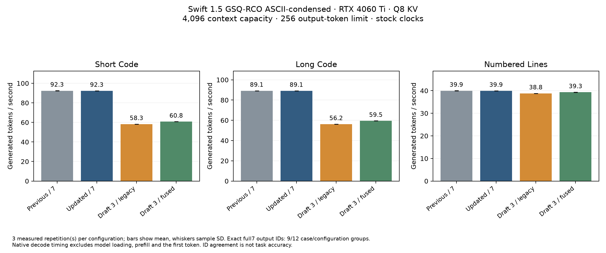

# 30 — Measured Ada priorities, ordered T4 IQ fusion and verification width

2026-10-15. RTX 4060 Ti 16 GB, stock clocks. Target: Swift 1.5 GSQ-RCO
IQ3_S ASCII-condensed, no MTP, SHA-256
`288a9a35ac8de49f3dc506dbd820c6213129248d519a3b51c4402c412f16f7a3`.
The earlier quantized model files are unchanged.

## Audit of the external architectural advice

The advice was written without inspecting this repository. It is a starting
point for experiments, rather than evidence that the suggested features are
missing or that their predicted gains apply here.

| Proposal | What the code and device actually show | Decision |
|---|---|---|
| Verify eight tokens per pass | `verify_external()` and `mk_cycle_wide` already support anchor + seven external proposals. | Reuse; investigate wasted verification when acceptance is low. |
| Cooperative launch and deadlock avoidance | The engine already launches one 512-thread CTA per SM and checks active CTAs for both kernel entries with `cudaOccupancyMaxActiveBlocksPerMultiprocessor`. | Preserve. One block per SM is this implementation's configuration, not the universal condition for cooperative correctness. |
| Persist all GDN state in L2/registers | Actual allocation is 48 × 48 × 128 × 128 F32 values: 144 MiB. L2 is 32 MiB, with 22 MiB maximum persisting set-aside on this device. | All-state residency is impossible in that cache budget; benchmark smaller working sets only if profiling justifies it. |
| Add L2 policies | Weight loads already use no-L1-allocation/evict-first PTX hints; recurrent/KV prefetch uses evict-last. | Distinguish existing hints from CUDA access-policy windows. Neither is a guarantee that arbitrary buffers remain pinned. |
| Introduce cp.async | Activation staging already uses `cp.async.cg.shared.global`, commit/wait and block barriers; attention has staged KV tiles. | Do not rewrite existing staging merely to add the same instructions. |
| T8 automatically becomes compute-bound | Reusing weights across tokens improves arithmetic intensity, but does not establish the measured limiting resource. | Use phase timings, register/spill reports and end-to-end tests. |
| GDN/QSA/MoE and FP8 loaders | This GGUF has 48 Gated DeltaNet layers and 16 full gated GQA layers, a dense FFN and mixed IQ/K weights. It is not an MoE/FP8 model. | Optimize the formats actually loaded. No new weight conversion. |
| Four stages must become two, losing 30% | Shared-memory limits are real; the asserted universal pipeline depth and percentage are not measurements of this code. | Measure each candidate, including register and synchronization costs. |

Primary architecture references: [NVIDIA Ada tuning guide](https://docs.nvidia.com/cuda/archive/13.0.0/ada-tuning-guide/index.html)
and [CUDA programming guide](https://docs.nvidia.com/cuda/archive/13.0.0/cuda-c-programming-guide/index.html).
The tuning guide documents Ada's register/shared-memory limits; the programming
guide describes occupancy queries, cooperative execution and persisting-cache
preferences. The table's allocation and existing-code findings come from this
repository and the local device query, not from unverified paper titles.

## Baseline and priorities

The previous sources, CUDA object, binaries and shared library were preserved in
`bench/ada-next/baseline/`, including SHA-256. Valid condensed-token prompt IDs
were extracted from stage 29's actual model run; full-vocabulary fixtures must
not be silently reused for the remapped tokenizer.

The fresh instrumented short-prompt profile reports a 63.110 ms average target
launch, with gate/up at 23.385 ms and down at 16.203 ms: **62.7% in the FFN**.
GDN core is 2.205 ms, about 3.5%. These are instrumented phase timings, not
production throughput. Even eliminating that core's cost would not deliver a
large overall speedup; cache experiments must be weighed against this share.

Priorities:

1. Preserve and validate numerical behavior with real quantized tensors, a CPU
   reference, token IDs, bounded tails, rejection/replay and seeded serving.
2. Extend the already useful ordered IQ gate/up fusion to T=4, which the current
   production path leaves on generic per-matrix dispatch. Keep T8 intact.
3. Evaluate shorter **target verification** for low-acceptance output while
   preserving the full noncausal DFlash draft block. Keep automatic policy opt-in.
4. Continue T8 FFN-down and quantized weight-decoder work with focused microbenchmarks;
   only integrate designs that beat the existing paired DP4A implementation.
5. Revisit loader/consumer specialization and persisting windows after a measured
   bottleneck warrants them. Earlier slower IMMA/pipeline prototypes are not
   promoted by this change.

## Hardware facts and changes under test

`tools/ada_capabilities.cu` is a read-only CUDA query. This GPU reports:
34 SMs; 65,536 32-bit registers per SM; 1,536 maximum threads per SM; 102,400
shared bytes per SM; 101,376 opt-in shared bytes per block; 33,554,432 L2 bytes;
23,068,672 maximum persisting bytes. The current persisting limit read back as
6,291,456 bytes; this tool did not set it. GDN state is 3 MiB per recurrent layer
and 144 MiB across all recurrent layers.

- `qwen38_mk.cu`: the existing `ffn_gu_iq<4,...>` implementation can now be
  selected with `MK_FFN_IQ_SMALL=1`. It shares gate/up activation loads and uses
  compile-time IQ dispatch while retaining ordered IQ2 accumulation. Default is
  off because the integrated output comparison is not universally identical;
  no additional KV/weight buffer is added.
- `tests/iq_small.cu`: checks all 36 pairs of six real IQ formats for four tokens,
  with zero and varying Q16 inputs. **13,824 floating results exactly match the
  ordered legacy GPU path**; CPU GGML-dequantized weights and double-precision
  dots give maximum NRMSE `1.52944503e-7`, maximum absolute error
  `4.35102834e-7`. This tests the arithmetic helper; integrated outputs still need
  independent checking.
- `dflash_verify_policy.h`, `capi.cpp`, `dflash_main.cpp`: optional `full`, `3`
  and `auto` policies truncate only the target verification prefix. The DFlash
  noise block remains at the configured training width, preserving its
  noncausal candidate context. `--draft 3` is a different experiment: it changes
  the draft block itself and must not be labelled the same optimization.
- The deterministic auto policy estimates prefix survival from accepted counts,
  handles censored fully accepted short verifications, starts with full width,
  and periodically probes full width. Its 0.85 cost threshold is an experimental
  Ada heuristic, not an online measurement of every GPU/context. Timing noise
  does not select widths. State resets on fresh prefill/checkpoint rewind.
- `serve_ada.py` and `server/mk_server.py`: `--verify-width 3|auto` opts into this
  policy and enables the T4 fast path unless `MK_FFN_IQ_SMALL` was explicitly set.
  Existing commands retain full-width defaults. Raw C API/CLI callers can use
  `MK_DFLASH_VERIFY` and `MK_FFN_IQ_SMALL` explicitly.
- `bench/ada_verify_bench.py`: alternating A/B order, actual matching tokenizer
  fixtures, binary hashes, output IDs, acceptance, policy counts and timing
  ranges. It distinguishes preserved/updated binaries, legacy depth 3, fused
  depth 3, full-trained-block verification 3, and adaptive verification.

The host policy tests pass full/fixed/auto, warmup, probing, reset and invalid
configuration cases. The optimized sm_89 build completed. `mk_cycle_wide` retains
128 registers and the previous reported stack/spill sizes; the small-shape entry
also uses 128 registers, with a 3,728-byte stack versus 3,712 previously and
additional compiler-reported spill instructions. Those static counts do not
measure dynamic spill traffic. The occupancy checks still pass on this device.

The initial 128-output-token screening run is in `bench/ada-next/screen/`:

| Configuration | Short code tok/s | Long code tok/s | Numbered lines tok/s |
|---|---:|---:|---:|
| Preserved binary, seven proposals | 97.90 | 88.97 | 41.05 |
| Updated binary, seven proposals | 97.45 | 88.78 | 40.99 |
| Three proposals, legacy T4 | 60.00 | 55.50 | 40.12 |
| Three proposals, fused T4 | 62.54 | 57.80 | 40.93 |
| Full trained draft, verify three | 60.55 | 55.32 | 38.85 |
| Full trained draft, automatic verification | 97.19 | 88.57 | 40.81 |

These are **single screening samples**, not uncertainty estimates or a broad
quality evaluation. Fused T4 retains the legacy three-proposal output IDs on all
three fixtures; long-code output differs between three and seven proposals, as
it already does without this fusion. Auto keeps all seven candidates on the two
code fixtures and takes some shorter verifications on numbered output. Neither
shorter verification nor auto wins this screening; they remain experiments.
### Three-repetition result

The controlled follow-up used three alternating process repetitions, the same
three model-specific fixtures, Q8 KV at 4,096 capacity, chunk 128, greedy decoding,
and a 256-output-token limit. It is in `bench/ada-next/comparison/`.

| Configuration | Short code tok/s | Long code tok/s | Numbered lines tok/s |
|---|---:|---:|---:|
| Preserved binary, seven proposals | 92.329 ± 0.179 | 89.138 ± 0.092 | 39.940 ± 0.054 |
| Updated binary, seven proposals | 92.290 ± 0.063 | 89.149 ± 0.015 | 39.947 ± 0.009 |
| Three proposals, legacy T4 | 58.273 ± 0.006 | 56.214 ± 0.020 | 38.806 ± 0.007 |
| Three proposals, fused T4 | 60.764 ± 0.018 | 59.473 ± 0.005 | 39.300 ± 0.017 |

Values are means ± sample standard deviation, not confidence intervals. The
updated full-width path retains all three preserved output-ID sequences and
shows no meaningful throughput improvement or regression. Fused T4 gains
**4.27%, 5.80%, and 1.27%** over legacy T4. The long and numbered gains also include
changes in acceptance/cycle count; they must not all be attributed to raw dot
throughput. Seven proposals still beat these smaller shapes on both coding
fixtures and narrowly on numbered output. There is no new general win over
llama.cpp in this experiment; no fresh llama.cpp throughput comparison was run.

All configurations repeat their own output IDs across the three processes.
Fused T4 matches legacy T4 on the two code fixtures, but **numbered output differs
starting at token index 164** (`biological` versus `physiological`, followed by
different text). This is an integrated numerical difference that the isolated
dot oracle does not rule out. Its logit margin and first divergent intermediate
have not been localized, so it is not labelled a proven near-tie or a correctness
fix. The fixture itself is a throughput workload, not a scored instruction-
following benchmark. T4 fusion therefore remains **off by default**, available
for experiments with `MK_FFN_IQ_SMALL=1`. Fixed/auto prefix verification remains
optional too. The existing seven-proposal serving configuration is retained.



The plot also ships as SVG/PDF. Raw commands, environment flags, binary hashes,
all generated IDs, policy counts, acceptance and timings are in `results.json`
and the per-process logs. No broad accuracy equivalence follows from these checks.

The context-scaling evaluator now reads the actual GGUF EOS ID (129,746 here,
rather than the original 248,046), verifies matching target/draft tokenizers,
checks ID ranges and rejects lengths too small for the chat layout. A different
target requires explicit prompt IDs. This prevents benchmarking repeated special
tokens or the wrong vocabulary as if they were a valid long-context workload.
Fourteen Python unit tests pass with the local `gguf-py` on `PYTHONPATH`.

## Completed validation and deployment

- **72 external verifier cases:** 36 rejection/acceptance combinations per Q8
  and Q4 cache, with `MK_FFN_IQ_SMALL=1`. Scalar continuation IDs, recurrent replay,
  borrowed weight bytes, invalid-proposal handling and chunked feature capture
  pass. These bounded fixtures do not negate the longer numbered-output difference.
- **13,824 arithmetic results:** exact legacy GPU dot agreement and the CPU
  GGML/double tolerance described above. Compute Sanitizer memcheck reports
  **zero errors for this isolated T4 arithmetic test**. This is not a full-engine
  memory-safety audit.
- **32 real HTTP/CUDA checks:** 16 at 8,192/Q8 with fixed three-candidate target
  verification and 16 at 96,000/Q4 with automatic verification. Both retain the
  full seven-proposal draft. Greedy/seed repeat, streaming, generation budgets
  1/2/3/7/8/9, sampler rejection, second-turn prefix reuse, reasoning, structured
  tools and tool-result reuse pass.
- After synchronization, **13 additional HTTP checks** pass through the active
  `open-jet/` server at 4,096/Q8 with unchanged defaults. Its startup log confirms
  full-width verification and T4 fusion off. This also checks the relocated
  library path; the total is **45 HTTP/CUDA checks** across the three runs.
- The 96K run retrieves `ORION-4060` from a **35,330-token populated prompt**.
  Prefill takes 132.92 seconds, followed by eight output tokens in 0.18 seconds.
  Whole-device NVML memory is 15,339/16,380 MiB. CUDA reports 14.936 GiB used and
  0.719 GiB free near the beginning of the run. Full-96K populated-context quality
  remains untested; this is a capacity and bounded retrieval validation.
- **14 Python tests** and the standalone deterministic verification-policy tests
  pass. The context evaluator rejects a real original-vocabulary fixture used
  with the condensed target before launching CUDA.

Validated sources, launchers and build products are synchronized into the active
`open-jet/megakernel/` tree and the standalone repository. The active launcher
retains its workspace-specific model search root. Previous binaries and critical
sources remain in the ignored local `bench/ada-next/baseline/` rollback directory.
`MK_FFN_IQ_SMALL` defaults off; verification defaults full. No model weight,
quantization payload, GPU clock or power setting was changed in this stage.
`bench/ada-next/SHA256SUMS` pins the resulting sources and runtime binaries;
`gpu-validation.json` records commands and return codes.

Next priorities are to localize the first integrated T4 intermediate/logit
difference before enabling it by default, then microbenchmark ordered T8
FFN-down/IQ decoding and executed spill traffic. Repeat the phase profile and
full-versus-short verification comparison on populated long-context agent/tool
workloads; the short-context cost ratio cannot be assumed to transfer there.

## Precision limits

The existing seven-of-nine native/scalar greedy agreement is not a promise of
bitwise parity with llama.cpp. Smaller matrix shapes and reduction paths can
change near-tied token choices; widths must be compared with matched baselines.
New arithmetic changes require the CPU oracle and integrated ID checks before
promotion. Automatic width remains optional even if it is faster on a fixture.

The observed `café` → `cafÿ` regression is present in both MK and llama.cpp with
the pruned target, while full-vocabulary Swift copies the text correctly. This
is evidence of a vocabulary-pruning trade-off, not something a cache/occupancy
change can be claimed to fix. Q4 KV is another independent lossy choice; numerical
comparisons use Q8 first. Broad task quality, perplexity and full-96K population
remain separate validation work.

## Reproduce the controlled comparison

From the standalone repository root after building the CUDA targets:

```bash
python3 megakernel/bench/ada_verify_bench.py \
  --model /path/to/Swift-1.5-Qwen3.8-27B-GSQ-RCO-IQ3_S-ASCII-Condensed-noMTP.gguf \
  --draft-model /path/to/Qwen3.8-27B-DFlash2-ASCII-Condensed-Q4_K_M.gguf \
  --fixture-report megakernel/bench/swift-condensed-validation/greedy-q8/results.json \
  --variants full7 depth3 fused3 --reps 3 --tokens 256 \
  --output megakernel/bench/ada-next/reproduction
python3 megakernel/bench/plot_ada_verify.py \
  megakernel/bench/ada-next/reproduction/results.json
```

The `depth3` and `fused3` configurations isolate the T4 change within the same
binary and draft width. Comparing either to `full7` changes verification shape
and acceptance, so that is a serving-configuration comparison rather than an
isolated arithmetic speedup. Add `verify3 adaptive7` to measure the optional
prefix policies; do not assume they are faster. To compare a preserved older
executable too, supply `--baseline-binary /path/to/qwen38_dflash` and include
`preserved7` in `--variants`. Preserved build products are local rollback
artifacts, excluded from Git.

For the next target-kernel experiment, the measured FFN share gives a useful
budget: reducing FFN time by 10% would imply about 6.7% faster **target launches**
under this profile's proportions, before draft/host costs. Eliminating half of
the GDN core's time would imply only about 1.8%. These are Amdahl estimates, not
promised throughput gains. Focus the next prototype on ordered T8 IQ decoding,
FFN-down activation reuse and dynamically executed spills, with a microbenchmark
and CPU oracle before another large persistent-kernel rebuild.
