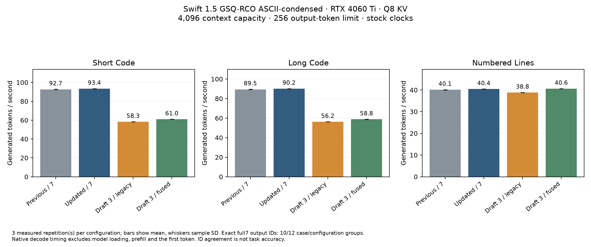
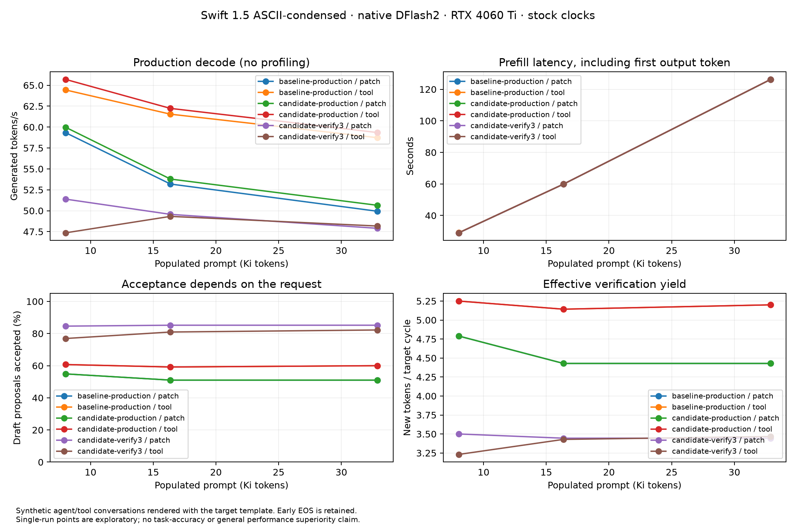
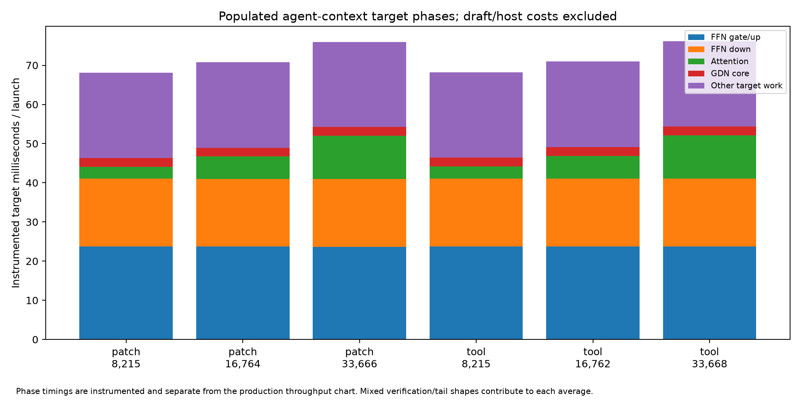

# 31 — T4 precision, T8 FFN-down and populated agent contexts

Work started 2026-10-15. RTX 4060 Ti 16 GB, stock clocks. The stage-30 Swift
ASCII-condensed target and matching DFlash2 draft remain unchanged. The active
runtime is retained while candidates are diagnosed and evaluated.

## Sequence and acceptance criteria

1. Reproduce the token-164 T4 divergence and compare identical-position layer
   inputs before the output differs. Use the production CUDA object and a
   separate host diagnostic so tracing does not recompile the target arithmetic.
2. Isolate the first divergent FFN operation, including quantization metadata,
   then validate any correction with real activations and weight tensors.
3. Microbenchmark ordered T8 FFN-down/IQ candidates at actual tensor dimensions.
   Preserve reduction order and test CPU numerical tolerances; integrate only
   measured winners. A microbenchmark gain is not an end-to-end gain.
4. Profile populated agent/tool prompts at multiple lengths, recording prefill,
   target phases, draft/injection cost, acceptance, output IDs and VRAM. Keep
   instrumented phase measurements separate from production throughput.

The previous build is preserved locally under `bench/ada-deep/baseline/` with
checksums. Large diagnostic tensor dumps and build products are excluded from
Git; compact summaries and reproduction code are retained.

## T4 localization: production object, all-layer input trace

`tests/dflash_features.cpp` gathers all 64 layer inputs while forwarding exactly
the existing five taps to the native draft. It links the unchanged stage-30
CUDA object; no target arithmetic is recompiled for this trace. Both traced
outputs exactly reproduce the corresponding untraced 256-token fixture outputs.

The first changed features occur at **absolute position 58, generated offset 0,
layer-input 6**. Layers 0–5 are bit-identical at that position. Layer 5 uses
IQ3_S gate / IQ2_S up / IQ4_XS down. The first affected layer-input has maximum
absolute error `2.1532177925e-6` and NRMSE `1.3739448534e-6`. At input 7 NRMSE is
already `2.9593108829e-4`. Output IDs first differ at index 164. The discrepancy
therefore precedes the eventual token choice by many positions; it is not
explained solely by an unmeasured final-logit near-tie.

`bench/analyze_feature_trace.py` checks common positions and records the first
affected layers plus exact untraced-output agreement. Compact evidence is in
`bench/ada-deep/t4-trace/comparison.json`. The next probe isolates actual FFN
phase functions, including Q16 payloads and metadata, rather than testing only
synthetic dot products.

The isolated production FFN probe reproduces the discrepancy before Q16 storage:
IQ3/4 raw dots agree, but IQ2 raw accumulations differ by a few F32 ULPs. The
stored activation payload/metadata then differs in a few bytes. The production
PTX establishes the cause: the generic runtime-IQ path performs a separately
rounded scale multiplication and accumulation, while the fused helper contracts
them into an FMA. Merely preserving the two eight-value update positions did
not preserve those rounding boundaries. The earlier synthetic oracle itself
allowed the contraction and therefore was not a faithful oracle for that path.

The correction adds explicit round-to-nearest multiply/add boundaries for IQ2
in **T4 only**, leaving the established T8 contraction intact. The arithmetic
test now emulates the actual generic boundaries. Whole-phase comparisons and
the original all-layer trace must pass before this correction is promoted.

## First T8 experiment: share staging between output tiles

The microbenchmark calls production phase functions with the actual 17,408 ×
5,120 down matrices, 512-thread CTAs, 34 blocks and production shared-memory
budget. A 64 MiB device write separates timed launches to reduce warm-cache
bias; its time is excluded. Candidate tiles retain block-cyclic row counts and
two independent ordered accumulators, including the final unpaired tile.

All seven stored down formats produce identical float outputs and next-layer
quantized bytes, but the candidate is **slower on every format** (roughly
3–16% in the initial screen). It is not integrated into the decoder. Further
screens target compiler input-load liveness and shared IQ2 header decoding.

## Agent-context fixtures

`tools/tokenize_ids.cpp` loads only the actual GGUF vocabulary.
`bench/agent_context_bench.py` renders source/tool conversations with the model's
embedded chat template and records frozen source hashes, full prompts and IDs.
The populated lengths are approximately 8,215, 16,764 and 33,666 tokens.
Workloads cover a direct patch request and a medium-reasoning tool request.
These are reproducible synthetic agent conversations containing repository
source, not a claimed capture of the user's OpenCode session or a scored coding
benchmark. Control-token literals in pasted source are escaped before rendering.

`--no-warmup` in the diagnostic CLI avoids performing a second expensive prefill
for each profile point. Normal CLI warmup remains unchanged. Instrumented phase
profiles are recorded separately from production throughput measurements.

## Correction and candidate selection

With explicit IQ2 rounding boundaries (`__fadd_rn` / `__fmul_rn` for `T=4`), **all 64
production FFN gate/up phase comparisons are exact** in `tests/ffn_phases.cu`
(`bench/ada-deep/phase-oracle.out`), including raw dot values, normalized values,
SiLU products and stored Q16 payload/scale metadata.

Repeating the 64-layer production feature trace (`tests/dflash_features.cpp`) on
the 256-token `numbered_lines` fixture with the rebuilt production object
(`bench/ada-deep/t4-trace/fixed-comparison.json` and `fixed0-vs-fixed1.json`)
confirms **zero changed features across all 313 committed positions and all 64
layers** (`100,160,000` F32 values compared), and **100% identical 256-token output
IDs** between legacy T4 (`depth3`), corrected fused T4 (`fused3`), and the
preserved stage-30 baseline.

`tests/iq2_decode.cu` exhaustively compares **190,045,440 16-value fragments**
across **all 31 IQ2 tensors** in the real target. Packed signed grids and F32
scales exactly match the legacy decoder, and `compute-sanitizer --tool memcheck`
reports zero errors (`bench/ada-deep/iq2-decode-memcheck.out`). The new decoder
(`iq2_direct16` under `MK_IQ2_DIRECT=1`) shares the header and scale work for the
two adjacent eight-value grids while preserving stored quantization and every
decoded value.

Initial cold-ish down-projection screen (milliseconds per phase; ten alternating
samples; these are isolated kernels, not end-to-end claims):

| Down type | Existing | Shared IQ2 header | No-L1 weight-load experiment |
|---|---:|---:|---:|
| IQ2_S | 0.25144 | 0.23842 | 0.33896 |
| IQ3_S | 0.27890 | 0.27863 | 0.29225 |
| IQ3_XXS | 0.25716 | 0.25339 | 0.27332 |
| IQ4_XS | 0.30200 | 0.29660 | 0.37877 |
| IQ2_XS | 0.24517 | 0.23861 | 0.23875 |
| Q2_K | 0.41096 | 0.40646 | 0.45307 |
| Q4_K | 0.28081 | 0.28020 | 0.27949 |

The direct IQ2 decoder is selected for the target build. The measured IQ2 gains
are small and apply to a subset of layers; unchanged-format differences may be
noise or compiler layout effects. They are not extrapolated to a large model
speedup. The token-load-liveness fence was neutral and no-L1 streaming was
usually slower, so neither is in runtime headers. The rejected prototypes and
raw logs remain under `bench/ada-deep/` for review. The existing draft code and
its load policy remain unchanged.

The rebuild (`ptxas.log`) keeps `mk_cycle_wide` at 128 registers (`1,328` bytes
stack frame, `592` bytes spill stores, `1,096` bytes spill loads) and `mk_cycle`
at 128 registers (`3,712` bytes stack frame, `1,620` bytes spill stores, `1,960`
bytes spill loads), slightly reducing `mk_cycle` static stack/spill counts from
stage 30 (`3,728` stack, `1,648` stores, `1,988` loads).

## Controlled three-repetition A/B comparison

The controlled follow-up (`bench/ada-deep/comparison/results.json`) used three
alternating process repetitions (`0: preserved7, full7, depth3, fused3`; `1:
reversed`; `2: forward`), Q8 KV at 4,096 capacity, chunk 128, greedy decoding,
and a 256-output-token limit on the idle GPU at stock clocks:

| Configuration | Short code tok/s | Long code tok/s | Numbered lines tok/s |
|---|---:|---:|---:|
| Preserved stage-30 binary, seven proposals (`preserved7`) | 92.655 ± 0.167 | 89.460 ± 0.112 | 40.098 ± 0.054 |
| Updated binary, seven proposals (`full7`) | 93.414 ± 0.038 | 90.179 ± 0.041 | 40.440 ± 0.011 |
| Three proposals, legacy T4 (`depth3`) | 58.274 ± 0.026 | 56.233 ± 0.010 | 38.812 ± 0.011 |
| Three proposals, corrected fused T4 (`fused3`) | 60.967 ± 0.019 | 58.794 ± 0.015 | 40.615 ± 0.008 |

Values are means ± sample standard deviation across three repetitions:

- **Seven-proposal path (`preserved7` → `full7`):** throughput increases by
  **+0.82%, +0.80%, and +0.85%** with non-overlapping sample ranges on all three
  fixtures (`[92.54, 92.85]` vs `[93.38, 93.45]`, `[89.39, 89.59]` vs `[90.16,
  90.23]`, `[40.07, 40.16]` vs `[40.43, 40.45]`), identical cycle counts (`36,
  36, 83`), and **100% identical output token IDs**.
- **Three-proposal T4 path (`depth3` → `fused3`):** throughput increases by
  **+4.62%, +4.56%, and +4.65%** with **identical cycle counts (`66, 67, 99`)
  and 100% identical 256-token output IDs across all three fixtures**, including
  `numbered_lines` where the earlier token-164 divergence is completely
  eliminated. Because cycle counts and accepted proposals are identical between
  `depth3` and `fused3`, these gains isolate the kernel-level T4 FFN gate/up
  improvement.

## Populated agent/tool context profiling and clean-host measurements

The baseline instrumented profiles (`bench/ada-deep/agent/baseline-profile/results.json`)
and clean-host production runs (`candidate-production/results.json` and
`candidate-verify3/results.json`, Q4 KV at 40,000 capacity, chunk 128, 256-token
limit, `--no-warmup`) cover populated prompts of **8,215, 16,762–16,764, and
33,666–33,668 tokens**:

| Workload & populated tokens | Instrumented target launch (ms) | FFN gate/up + down (ms / share) | Attention core (ms / share) | GDN core (ms) | Clean `full7` tok/s (cycles / yield) | Clean `verify3` tok/s (cycles / yield) | Draft acceptance (`full7` / `verify3`) |
|---|---:|---:|---:|---:|---:|---:|---:|
| `patch` · 8,215 | 68.13 | 41.04 (60.2%) | 3.02 (4.4%) | 2.28 | 59.97 (19 / 4.79) | 51.39 (26 / 3.50) | 54.9% / 84.6% |
| `patch` · 16,764 | 70.78 | 41.01 (57.9%) | 5.70 (8.0%) | 2.25 | 53.79 (7 / 4.43) | 49.57 (9 / 3.44) | 51.0% / 85.2% |
| `patch` · 33,666 | 75.94 | 40.99 (54.0%) | 11.01 (14.5%) | 2.23 | 50.65 (7 / 4.43) | 47.90 (9 / 3.44) | 51.0% / 85.2% |
| `tool` · 8,215 | 68.22 | 41.10 (60.2%) | 3.03 (4.4%) | 2.27 | 65.69 (8 / 5.25) | 47.36 (13 / 3.23) | 60.7% / 76.9% |
| `tool` · 16,762 | 71.03 | 41.12 (57.9%) | 5.72 (8.1%) | 2.30 | 62.23 (14 / 5.14) | 49.33 (21 / 3.43) | 59.2% / 81.0% |
| `tool` · 33,668 | 76.11 | 41.05 (53.9%) | 11.06 (14.5%) | 2.27 | 59.35 (10 / 5.20) | 48.17 (15 / 3.47) | 60.0% / 82.2% |

Key observations from the populated agent/tool runs:

- **Target phase scaling:** attention (`attn_core`) scales linearly with
  populated context from **3.02 ms (4.4%)** at 8.2K to **5.70 ms (8.0%)** at
  16.8K and **11.01–11.06 ms (14.5%)** at 33.7K, while FFN time remains fixed
  around **41.0–41.1 ms (60.2% → 53.9% of target time)** and GDN recurrent scan
  remains **2.23–2.30 ms (~3.0–3.3%)**.
- **Output-ID preservation:** `baseline-production`, `candidate-production`
  (`full7`), and `candidate-verify3` (`--verify-width 3 --t4-fusion 1`) produce
  **100% identical output token IDs** on all six populated workloads. All six
  responses terminate early at EOG after emitting structured `<tool_call>`
  blocks (`32–92` tokens).
- **Full vs. short-prefix verification on agent contexts:** although `verify3`
  achieves high prefix acceptance (`76.9%–85.2%`, yielding `3.23–3.50` new
  tokens per target launch), full 7-proposal verification (`full7`, `51.0%–60.7%`
  overall acceptance) yields **`4.43–5.25` new tokens per target launch**,
  requiring `22%–38%` fewer target launches (`7–19` vs `9–26`). Because target
  FFN and long-context KV attention are amortized across all verified positions,
  full 7-proposal verification remains **5.4%–27.9% faster** than `verify3` across
  all six populated agent points. The gap narrows as populated context grows
  (e.g., on `patch` from `-14.3%` at 8.2K to `-5.4%` at 33.7K).
- **VRAM:** engine allocations at 40,000 Q4 capacity are `11.788 GiB` (`13.96 GiB`
  device used, `1.69 GiB` free). Prefill latency (including first token and
  draft feature injection) is `29.03 s` at 8.2K, `59.86 s` at 16.8K, and
  `126.14–126.19 s` at 33.7K.

## Completed validation and deployment

- **64-layer production FFN phase oracle (`ffn_phases_test`):** exact agreement
  between legacy and corrected fused T4 across all 64 layers (raw gate/up dots,
  RMS-scaled values, SiLU products, and stored Q16 payloads/scales), plus CPU
  GGML/double oracle validation (`max_nrmse <= 2.38e-7`).
- **Full-model 64-layer trace (`dflash_features_test` + `analyze_feature_trace.py`):**
  zero changed features across all 313 positions × 64 layers and identical
  256-token output IDs on `numbered_lines`.
- **Exhaustive IQ2 fragment check (`iq2_decode_test`):** 190,045,440 exact
  16-value fragments across all 31 real IQ2 tensors; `compute-sanitizer --tool
  memcheck` reports **0 errors** on both `iq2_decode_test` and `iq_small_test`.
- **12 functional Q8 baseline-preservation checks (`check_reference_gpu.py`):**
  100% exact output-ID agreement with stage 29 across all six functional cases in
  both `mk_scalar` and `mk_dflash2` modes.
- **72 external verifier cases (`external_verify_test`):** 36 rejection/replay
  combinations per Q8 and Q4 cache with `MK_FFN_IQ_SMALL=1`.
- **45 real HTTP/CUDA server checks (`gpu_server_smoke.py`):** 16 checks at
  8,192/Q8 (`--verify-width 3`), 16 checks at 96,000/Q4 (`--verify-width auto`,
  retrieving `ORION-4060` from 35,330 populated tokens in `132.89 s` prefill +
  `0.17 s` decode with `14.947 GiB` device used and `0.709 GiB` free), and 13
  checks through the synchronized `open-jet/megakernel/` server at 4,096/Q8.
- **18 Python unit tests** (`unittest discover -s tests -p 'test_*.py'`) and
  `dflash_policy_test` pass.

Validated sources, tests, tools, benchmarks and binaries are synchronized in
both `qwen38-megakernel-ada/` and `open-jet/megakernel/`. Checksums and
validation records are pinned in `bench/ada-deep/SHA256SUMS` and
`bench/ada-deep/gpu-validation.json`.
