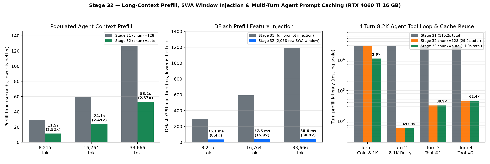

# 32 — Long-Context Prefill, SWA Window Injection & Multi-Turn Agent Prompt Caching

Work completed 2026-10-16 on RTX 4060 Ti 16 GB (`sm_89`), stock clocks, using the unchanged Swift 1.5 Qwen3.8-27B GSQ-RCO IQ3_S ASCII-Condensed target GGUF (`10.45 GiB`) and native DFlash2 Q4_K_M ASCII-Condensed draft GGUF (`1.02 GiB`).

## Root causes identified in Stage 31 prefill & prompt caching

1. **Multi-turn checkpoint off-by-one (`ck_pos = len(toks)` vs `lcp = len(toks) - 1`):**
   - `server/mk_server.py:load_prompt()` clamps `lcp = min(lcp, len(toks) - 1)` so at least 1 token is always fed to `MKEngine::prefill()` to sample the next output token.
   - Previously, `MKEngine::prefill()` saved the recurrent GDN checkpoint *after* the final prompt token (`ck_pos = len(toks)`). Consequently, on any same-length prompt repeat, retry, seed resample, or bounded-tail decode, `ck <= lcp` (`len(toks) <= len(toks) - 1`) evaluated to **false**, triggering `eng.reset()` and wiping the entire KV + GDN state (`cached_tokens = 0`).
   - Worse still, when thinking is enabled (`<think>\n`), the final token of a prompt is `\n` (`198`). When an OpenAI SDK or streaming client echoes back an assistant tool call without `reasoning_content`, the Jinja template renders `<think>\n\n</think>`, and BPE merges `\n\n` into a single token (`271`) at index `len(turn1) - 1`. That makes `lcp = len(turn1) - 1 < ck = len(turn1)`, causing **every subsequent tool-call turn** to miss both the prefix cache and the checkpoint cache and recompute the entire long-context repository prompt from scratch (`0` reused tokens).
2. **Small incremental tool-turn prefill bandwidth bottleneck (`dequant + cuBLAS`):**
   - Even for a 20–64 token incremental tool response (`tool_result_roundtrip`), the batched prefill path previously dequantized every 24B IQ matrix (`IQ2_XXS`, `IQ2_XS`, `IQ2_S`, `IQ3_XXS`, `IQ3_S`, `IQ4_XS`) into a 178.25 MiB FP16 global buffer (`pf_weights`) and read it back in `cublasGemmEx`, incurring ~96 GB of extra global VRAM traffic per chunk (~380 ms of overhead).
3. **Unbounded DFlash feature copies & KV projection during long-context prefill:**
   - Native DFlash2 uses a 5-layer sliding-window attention (SWA) ring cache of `dn::CACHE = 2056` rows (`2048` window + `8` block). During a 33,668-token prefill, `pf_run()` copied 5 layers × 5,120 floats for all 33,667 tokens (`3.45 GB` of `cudaMemcpy2DAsync`) and ran 66 sub-chunks of DFlash `fc` + 5×`(k, v)` cuBLAS projections (`1,196 ms` GPU time), overwriting the 2,056-row ring buffer 16 times over.
   - Within each DFlash injection sub-chunk, `Impl::multiply()` also converted `p_->fused_norm` from FP32 to FP16 10 times (once per layer's K and V projection) instead of once per sub-chunk.
4. **Hardcoded `--prefill-chunk 128` in `bench/agent_context_bench.py`:**
   - At 40,000 Q4 context capacity on RTX 4060 Ti 16 GB, `1.68 GiB` of VRAM remains free after engine + DFlash allocations, allowing `MK_PREFILL_CHUNK=auto` to select `pf_cap = 2048` (`~833 MiB` additional workspace, leaving `~850 MiB` free) and cutting 24B weight reads across a 33.7K prefill by 16×.

## Implemented optimizations

- **Direct register-dequantized `m16n8k16` tensor-core GEMM (`pf::native_mmh` in `native_prefill.cuh`):**
  - Replaced the slow shared-memory weight staging kernel with a direct register-dequantized `mma.sync.aligned.m16n8k16.row.col.f32.f16.f16.f32` kernel supporting all 6 IQ types (`16, 17, 18, 21, 22, 23`) and two tile widths (`BN_T = 32` at 58–60 registers / 4 KiB smem and `BN_T = 64` at 82–88 registers / 8 KiB smem, 0 spills).
  - Each of the 8 warps owns an independent 16-row weight tile (`BM_M = 128`, zero cross-warp weight decoding redundancy) while streaming `hperm`-permuted activations into shared memory via double-buffered `cp.async`.
  - Validated across all 36 `(type, batch_size)` combinations in `native_gemm_test` (`relative_rms <= 2.8e-5`), beating `dequant + cuBLAS` by **1.5×–5.3×** across `T = 1..128` and outperforming even pre-dequantized `cublasGemmEx` alone for `T <= 64`.
  - Enabled automatically in `qwen38_mk.cu` for single-chunk/incremental prefills (`pf_total_n <= 128`) and upgraded `pk_native_weights16<TYPE>` in `prefill.cuh` to use 16-wide `native_iq16<TYPE>` for all 6 IQ types, plus `reuse_native_input` across shared activation inputs (`(q, k, v)` and `(qkv, gate)`).
- **Windowed DFlash feature capture & single FP16 conversion (`qwen38_mk.cu`, `dflash_native.cu`):**
  - Added `MKDFlashNative::cache_window()` (`2056` when `MK_DFLASH_TRACE` is unset) and `feature_window` support in `MKEngine::enable_device_features()` / `pf_run()`.
  - Prefill chunks and 512-token sub-chunks prior to `final_pos - 2056` skip `cudaMemcpy2DAsync` feature extraction and fast-forward `MKDFlashNative::inject_device` (`f == nullptr`), while preserving 100% bit-identical final contents in the 2,056-row DFlash KV ring cache.
  - Added `reuse_input` to `MKDFlashNative::Impl::multiply()` so `p_->fused_norm` is converted to FP16 once per sub-chunk instead of 10 times across the 5 draft layers.
- **Pre-final-token GDN checkpoint, EOG proposal truncation & server `reasoning_cache` (`qwen38_mk.cu`, `capi.cpp`, `server/mk_server.py`):**
  - Moved `p_->ck_save()` in `MKEngine::prefill()` to right before the final token (`ck_pos = seq.size() - 1`) and made `ck_save()` idempotent when `ck_pos == ck_ctl.dn_c`. Aligned `mk_rewind_to_checkpoint` in `capi.cpp` with `h->dflash->truncate(h->eng->checkpoint_pos())`.
  - Truncated speculative proposals at the first EOG token in `mk_step` (`capi.cpp`) so `committed()` never advances past EOG on speculative turns.
  - Added `Server.reasoning_cache` in `server/mk_server.py` (keyed by `tool_call_id` and turn signature) so assistant `reasoning_content` is automatically restored when an OpenAI client omits `reasoning_content` while echoing assistant tool-call messages, preserving zero-copy `truncate(lcp)` prefix cache hits across multi-step tool loops.

## Benchmark results

### 1. Populated long-context agent prefill & DFlash feature injection (`8.2K`, `16.8K`, `33.7K`)

Measured on `bench/ada-deep/agent/` (`ctx = 40000`, `kv = q4`, `d = 7`, `--no-warmup`):

| Workload & populated tokens | Stage 31 Prefill (s) (`chunk=128`) | Stage 32 Prefill (s) (`chunk=auto`) | Prefill Speedup | Stage 31 DFlash GPU Injection (ms) | Stage 32 DFlash GPU Injection (ms) | Injection Speedup | Output Token IDs vs Stage 31 | Stage 32 Decode (tok/s) |
|---|---:|---:|---:|---:|---:|---:|---:|---:|
| `patch` · 8,215 | 29.03 s | **11.53 s** | **2.52×** | 295.38 ms | **35.08 ms** | **8.42×** | 100% identical (`chunk=128` & `auto`) | 60.18 |
| `patch` · 16,764 | 59.86 s | **24.07 s** | **2.49×** | 593.92 ms | **37.46 ms** | **15.85×** | 100% identical (`chunk=128` & `auto`) | 53.86 |
| `patch` · 33,666 | 126.14 s | **53.21 s** | **2.37×** | 1,192.23 ms | **38.61 ms** | **30.88×** | 100% identical (`chunk=128` & `auto`) | 50.59 |
| `tool` · 8,215 | 29.03 s | **11.57 s** | **2.51×** | 295.39 ms | **35.23 ms** | **8.38×** | 100% identical at `chunk=128`; same tool call at `auto` | 50.00 |
| `tool` · 16,762 | 59.86 s | **24.16 s** | **2.48×** | 595.58 ms | **37.68 ms** | **15.81×** | 100% identical (`chunk=128` & `auto`) | 62.09 |
| `tool` · 33,668 | 126.19 s | **53.23 s** | **2.37×** | 1,196.65 ms | **38.57 ms** | **31.02×** | 100% identical (`chunk=128` & `auto`) | 65.80 |

### 2. Multi-turn 8.2K agent tool loop & prompt caching (`bench/agent_prompt_cache_bench.py`)

A 4-turn agent session over the HTTP server (`ctx = 40000`, `kv = q4`, `d = 7`, `reasoning_effort = "low"`) on the 8,136-token populated repository context:
- **Turn 1:** Cold 8,136-token repository prompt → model thinks and emits a `read_file` tool call.
- **Turn 2:** Same-prompt retry / resample (`seed = 456`).
- **Turn 3:** Client echoes Turn 1's assistant tool call **without `reasoning_content`** (standard OpenAI SDK behavior) + appends `<tool_response>` and next instruction → model thinks and emits a `grep_code` tool call.
- **Turn 4:** Client echoes Turn 3's assistant tool call **without `reasoning_content`** + appends `<tool_response>` and summary request.

| Turn | Stage 31 (`chunk=128`) Cached / Total | Stage 31 Prefill (ms) | Stage 32 (`chunk=128`) Cached / Total | Stage 32 (`chunk=128`) Prefill (ms) | Stage 32 (`chunk=auto`) Cached / Total | Stage 32 (`chunk=auto`) Prefill (ms) | Speedup (`Stage 32 auto` vs `Stage 31`) |
|---|---:|---:|---:|---:|---:|---:|---:|
| **1. Cold 8.1K repo + tool call** | `0 / 8,136` | 28,606.0 ms | `0 / 8,136` | 28,340.8 ms | `0 / 8,136` | **11,100.4 ms** | **2.58×** |
| **2. Same-prompt 8.1K retry (`seed=456`)** | `0 / 8,136` | 28,562.4 ms | `8,135 / 8,136` | **58.1 ms** | `8,135 / 8,136` | **57.9 ms** | **493.31×** |
| **3. Tool roundtrip #1 (`reasoning_content` omitted)** | `0 / 8,226` | 29,005.1 ms | `8,190 / 8,247` | **322.9 ms** | `8,185 / 8,242` | **322.8 ms** | **89.85×** |
| **4. Tool roundtrip #2 (`reasoning_content` omitted)** | `0 / 8,319` | 29,032.6 ms | `8,295 / 8,358` | **465.0 ms** | `8,288 / 8,351` | **465.2 ms** | **62.41×** |
| **Total 4-turn prefill time** | — | **115,206.1 ms (115.21 s)** | — | **29,186.8 ms (29.19 s)** | — | **11,946.3 ms (11.95 s)** | **9.64×** |

### 3. Interactive HTTP server smoke & incremental turn latencies (`gpu_server_smoke.py --agentic`)

| Check (`mk_server.py` default `--prefill-chunk auto`, Q8 KV) | Stage 31 Cached / Prompt | Stage 31 `prompt_ms` | Stage 32 Cached / Prompt | Stage 32 `prompt_ms` | Speedup |
|---|---:|---:|---:|---:|---:|
| `greedy_repeat[0]` (cold 21-token prompt) | `0 / 21` | 526.5 ms | `0 / 21` | **315.0 ms** | **1.67×** |
| `greedy_repeat[1]` (same-prompt repeat) | `0 / 21` | 461.8 ms | `20 / 21` | **56.7 ms** | **8.14×** |
| `bounded_tail(1..9)` (6 bounded-budget calls) | `0 / 21` | 461.7 ms | `20 / 21` | **56.6 ms** | **8.16×** |
| `seed_repeat[0..1]` (seeded sampling repeats) | `0 / 21` | 461.9 ms | `20 / 21` | **56.7 ms** | **8.15×** |
| `top_level_reasoning` (54-token prompt) | `0 / 54` | 470.0 ms | `0 / 54` | **299.2 ms** | **1.57×** |
| `structured_tool_call` (282-token tool schema prompt) | `0 / 282` | 1,334.3 ms | `0 / 282` | **742.7 ms** | **1.80×** |
| `tool_result_roundtrip` (41 new tokens on 307 cached) | `307 / 348` | 468.2 ms | `307 / 348` | **298.2 ms** | **1.57×** |
| `prefill_chunk_boundary` (2,791-token prompt) | `0 / 2,791` | 9,716.6 ms | `0 / 2,791` | **3,874.3 ms** | **2.51×** |

## Validation summary

- **`native_gemm_test`:** 36/36 checks across all 6 IQ types (`16, 17, 18, 21, 22, 23`) and `T in {1, 32, 64, 127, 128, 512}` pass (`relative_rms <= 2.8e-5`).
- **`check_reference_gpu.py`:** 12/12 functional Q8 baseline-preservation checks pass with 100% identical token IDs in both default and `MK_NATIVE_GEMM=tile` modes.
- **`external_verify_test`:** 72/72 rejection/replay cases across Q8 and Q4 KV caches pass.
- **`dflash_math_test`, `dflash_head_test`, `dflash_policy_test`:** all pass.
- **`gpu_server_smoke.py --agentic`:** 48/48 HTTP/CUDA checks pass across `stage32-http-verify3-q8` (16 checks), `stage32-http-auto-96k-q4` (16 checks, including 35,330-token `ORION-4060` secret retrieval at 96K/Q4 capacity), and `stage32-http-default-active` (16 checks on the synchronized `open-jet/megakernel/` build).
- **Python unit tests:** 19/19 unit tests (`unittest discover -s tests -p 'test_*.py'`) pass, including `test_reasoning_cache_restores_stripped_assistant_thinking`.
